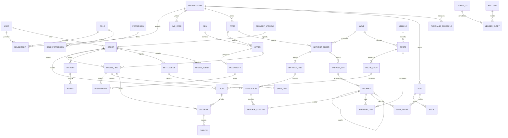
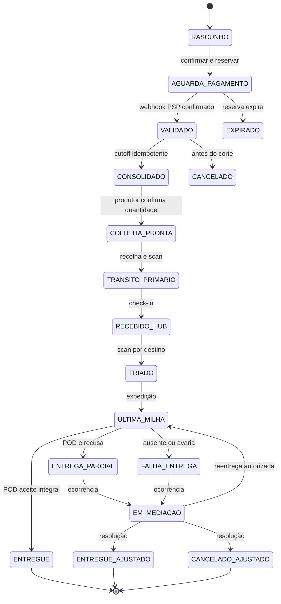

# ZUNGA — Arquitectura Farm-to-Table / Cross-Docking
## ADR-019 — proposta de arquitectura alvo, 18-11-2026

**Estado:** especificação técnica, não migração executada. A fundação Supabase V0.12 contém apenas perfis, bancadas e empresas; preservar identificadores, migrar por etapas e manter autenticação real adiada até autorização. V0.19 é um laboratório local separado das encomendas V0.18, não uma operação real. Piloto Huíla, fuso Africa/Luanda, moeda AOA, valores em unidades monetárias mínimas inteiras no backend (não floats). Horários abaixo são exemplos configuráveis, não promessas de serviço.

## 1. Modelo de domínio e DER

### Dicionário de tabelas (PK UUID salvo indicação; FK indicadas por *_id)
| Domínio | Tabela e principais campos / relações |
|---|---|
| Identidade | users (id = auth.users.id, profile, language, status); organizations (id, kind buyer/company/farm/hub/carrier/platform, legal_name, nif quando exigido, status); memberships (user_id, organization_id, role_id, status, unique triplo); roles, permissions, role_permissions (PK compostas); kyc_cases (org_id, status, reviewer_id, reviewed_at), private_documents (kyc_case_id, object_key, checksum, retention_until). |
| Origem | farms (org_id, zone_id, address_id, active); skus (category, canonical_name, unit, packaging, weight_per_unit_g nullable, grade, perishable); offers (farm_id, sku_id, base_price_minor, min_qty, published); price_tiers (offer_id, customer_segment, min_qty, price_minor, effective dates); availability (offer_id, harvest_date, capacity_qty, reserved_qty, version); reservations (availability_id, order_line_id, qty, expires_at, status). |
| Clientes | addresses (owner/org, zone_id, coordinates protected); zones (hub_id, polygon/zone codes, serviceability); delivery_windows (zone_id, starts_at, ends_at, capacity, segment); purchase_schedules (org_id, cadence, next_run, spending_cap, status, consent); schedule_lines (schedule_id, offer_id, qty, substitution_policy). |
| Comércio | orders (customer_id, organization_id nullable, channel, window_id, address snapshot, currency, totals_minor, commercial_status, fulfillment_status, payment_status, financial_status, version, idempotency_key, pricing_rule_version); order_lines (order_id, offer_id, sku_id, farm_id, qty, unit_snapshot, price_minor, discount_minor, tax_snapshot); quote_requests, quote_responses; invoices (order_id, issuer_org_id, fiscal reference, tax, status, issued_at), credit_notes (invoice_id, refund_id). |
| Planeamento | policy_versions (scope, effective_at, cutoff_local, hub window, B2B window, rate table, created_by); waves (service_date, hub_id, cutoff_at, policy_version_id, status, unique hub/date/version de execução); harvest_orders (wave_id, farm_id, revision, status, unique wave/farm/revision); harvest_lines (harvest_order_id, sku_id, offer_id, qty, unit); allocations (harvest_line_id, order_line_id, qty, unique por linha e plano activo). |
| Rastreabilidade | harvest_lots (harvest_order_id, farm_id, sku_id, harvest_at, expiry, quality, qty); packages (lot_id nullable para master, parent_id nullable, type MASTER/CHILD, immutable label_token unique, seal, state, weight_g); package_contents (package_id, allocation_id, qty); scan_events (package_id, hub_id, dock_id, event_type, actor_id, device_id, client_event_id unique por dispositivo, captured_at, received_at); custody_events (package_id, from_org, to_org, scan_id, occurred_at); hub_exceptions (package_id, reason, disposition, SLA). |
| Transporte | hubs (org_id, location, operating schedule, capacity); docks (hub_id, code, capacity); carriers (org_id, capability PRIMARY/LAST_MILE/BOTH); vehicles (carrier_id, plate, capacity_g, capacity_volume, status); routes (wave_id, leg PRIMARY/LAST_MILE, zone_id, carrier_id, vehicle_id, driver_id, plan_version, status, capacity); route_stops (route_id, seq, address_id, planned_window, status); shipment_legs (package_id, route_id, pickup_stop_id, drop_stop_id, status); route_assignments (route_id, driver_id, assigned_at, ended_at, reason); tracking_events (route_id, coords, accuracy, timestamp, retention). |
| Entrega | pods (order_id, stop_id, method, token_hash/proof_object_key, verified_at, driver_id, client_event_id, status); pod_lines (pod_id, order_line_id, accepted_qty, refused_qty); incidents (order_line_id, pod_id nullable, category, qty, evidence_path, status, responsibility); disputes (incident_id, opened_by, status, resolution, approver_id, due_at); dispute_events. |
| Financeiro | payments (order_id, provider, external_id unique, idempotency_key unique, authorized/captured_minor, status); payment_events (provider, event_id unique, verified_at); refunds (payment_id, dispute_id, amount_minor, provider_ref, status, idempotency_key); settlements (order_id, revision, policy_version_id, status); split_lines (settlement_id, beneficiary_org_id, component, amount_minor, payout_status, provider_ref); ledger_accounts (owner_org, currency, type); ledger_transactions (source_type, source_id, unique idempotency_key, posted_at, reverses_id); ledger_entries (tx_id, account_id, debit_minor, credit_minor); payouts (beneficiary, settlement_id, provider_id, status); reconciliations (provider transaction, ledger transaction, difference, status). |
| Operação | order_events (order_id, from/to, actor_id, event_type, correlation_id, reason, payload, occurred_at, sequence); audit_logs (actor_id, org_id, action, resource_id, before/after redacted, request_id, timestamp); outbox (event_id, aggregate_id, sequence, payload, published_at, attempts); inbox (consumer, event_id unique); notification_jobs (recipient, channel, template, status, attempts); idempotency_keys (scope, key, request_hash, result reference). |

### Invariantes
- Quantidade normalizada por unidade de SKU; kg/g e volumes/pacotes não se somam sem conversão explícita. Peso de veículo exige peso real ou conversão validada, não número de sacos.
- Uma compra pode ter vários produtores e entregas. Uma linha pode dividir-se em alocações e embalagens; quantidade total alocada <= reservada e aceite + recusada <= expedida. Cada sub-etiqueta pertence a um master e tem conteúdo rastreável; reembalagem cria evento e novas referências, sem apagar origem.
- Reserva transacional com bloqueio da disponibilidade, expiração e idempotência; pedidos pendentes não entram no corte. Não reter quantidade duas vezes. Preços, fretes, taxas e janelas versionados por pedido. Alterações futuras não reprecificam históricos.
- FKs e índices por org, farm, service_date, wave/status, route/stop, package label e order/event; índices únicos para evitar corte/scan/refund/payout repetidos; version para concorrência otimista. Ledger append-only, débitos=créditos por moeda; estorno por lançamentos compensatórios.
- Separar estado comercial, físico, pagamento e liquidação. Não permitir que avanço visual de encomenda confirme pagamento, POD ou repasse. Cancelamento pré-corte liberta reserva e pede estorno; após corte abre exceção para impedir dupla venda, perda de rastreabilidade e duplo reembolso.
- Hub é transbordo, com inventário transitório e quarentena segregada, não stock à venda. Limite de permanência, temperatura/qualidade conforme SKU; exceções não são expedidas sem autorização.
- RBAC: cliente apenas pedidos próprios; comprador de empresa apenas org e limites de aprovação; agricultor apenas suas ofertas, lotes e ordens; operador apenas hubs atribuídos e dados necessários para triagem; transportador apenas rota e paragem atribuídas, dados mínimos do destino; administrador por permissões (ops, KYC, finance, support, audit, platform), MFA e dupla aprovação em ajustes de valor. Nunca confiar no role de localStorage nem em metadata editável pelo utilizador. RLS por membership/ownership/assignment, default deny, backend valida cada comando; storage privado com URLs temporários. Sem segredos no frontend.
- PII, comprovativos e geolocalização minimizados; registo de consentimento e retenção; exportação/auditoria sem dados desnecessários. Faturas e custódia dependem de validação fiscal/jurídica e PSP autorizado no mercado de lançamento.

## 2. Máquinas de estados e comandos

Estado comercial e físico composto para leitura; máquinas internas por linha, pacote, rota e pagamento. Um pedido agregado é entregue integralmente apenas se todas as suas linhas forem aceites; parcial se houver aceite + recusa/falha; terminal depois de todas resolvidas.

| Evento | Autor / pré-condição | Efeito transacional |
|---|---|---|
| checkout.confirm | cliente com janela/capacidade, oferta activa, preço vigente | reserva, pedido pendente, intent PSP; idempotency key. |
| payment.verified | webhook autenticado, montante/moeda/identificador conferidos | validado, confirmação da janela; falha/expiração liberta reserva. |
| wave.close | scheduler autorizado; service date, cutoff timezone e capacidade; lock único | snapshot apenas pedidos validados e reservados; consolida farm/SKU/unidade/data/hub; outbox de ordens. Após corte vai para próxima janela disponível. |
| harvest.ready | produtor responsável, lote e quantidade conferidos | regista colheita/qualidade/peso, etiqueta master e sub-etiquetas. Falta parcial abre ocorrência, replaneia ou reembolsa. |
| primary.pickup | motorista atribuído e aceite; scan master | custódia muda, viagem em trânsito; ETA estimada. |
| hub.receive | operador hub certo; scan token único, janela, selo/qty | check-in, reconcilia carga; atraso ou divergência cria exceção. |
| hub.sort / dispatch | operador atribuído; scan de cada caixa, rota/capacidade | doca/rota correcta; expede apenas triado e aceite, regista custódia. |
| delivery.pod | motorista atribuído ao stop; OTP cliente validado no servidor OU foto/assinatura conforme política | accepted_qty/refused_qty, prova privada; não basta checkbox; falta de cliente gera falha, não POD falso. |
| quality.refused | motorista e cliente, qty limitada e evidência | ocorrência, calcula crédito/refund, congela parcela afectada; restituição solicitada idempotente ao PSP conforme política aprovada; prazo de confirmação depende PSP. |
| dispute.resolve | suporte/financeiro autorizados, motivo e evidência; aprovação dupla se limiar | resolução, reentrega, crédito, refund ou compensação; ajusta ledger, repasse e invoice/credit note. |
| settlement.prepare | POD aprovado, montantes capturados e conciliados; sem disputa aberta sobre parcela | calcula split com snapshot e quantidades aceites, contabiliza obrigações, aguarda PSP. |
| payout.confirm | webhook/consulta conciliada de PSP | marca pago apenas após confirmação; falhas retry/reconciliação, nunca duplicar. |
| route.reassign | operador autorizado, rota e motorista elegíveis | versiona atribuição, mantém scans e custódia; se carga já recolhida exige transferência auditada. |

### Estado financeiro independente
NOT_PAID -> PAYMENT_PENDING -> AUTHORIZED (se suportado) -> CAPTURED/CONFIRMED -> SETTLEMENT_PENDING -> PAYOUT_PENDING -> SETTLED. Alternativas FAILED/EXPIRED; REFUND_PENDING -> PARTIALLY_REFUNDED/REFUNDED; DISPUTED/HOLD; RECONCILIATION_REQUIRED. Autorização pode expirar; escolher método de captura segundo PSP. Não chamar escrow ao saldo interno. Custódia verdadeira, split e KYC de recebedores dependem de contrato e autorização do PSP. Se PSP não suportar retenção/split, validar modelo alternativo de pagamentos directos e faturação de serviços antes do go-live.

### Financeiro e conservação de valores
P = valor líquido dos produtos aceites (descontos incluídos); F = frete/transbordo cobrado ao cliente conforme snapshot; C = comissão sobre P; G = custos do processador, com pagador definido em política; H = taxa hub; T1 e T2 = fretes das pernas; demais tributos e subsídios explicitados. Exemplo de política: H+T1+T2=F; produtor=P-C-G; plataforma=C; PSP=G. Com reembolso R, total capturado = total reembolsado + valores líquidos a beneficiários + taxas + saldo pendente. Se tarifas fixas não devolvidas, mostrar política ao cliente antes de pagar. Arredondamento determinístico por maior resto; nunca negativo, nunca exceder capturado; comissões recalculadas sobre aceite e snapshot, custos reais não reembolsáveis tratados por política. Refund não é instantâneo até confirmação do PSP; crédito interno só com política/consentimento apropriados. Uma recusa de qualidade não autoriza pagamento da parcela afectada.

## 3. Arquitectura de serviços e APIs

**Decisão:** monólito modular inicialmente, com PostgreSQL/Supabase como fonte única e fronteiras de domínio explícitas. Não criar 12 microsserviços/filas externas pagos no piloto. Frontends PWA separados por perfil, Cloudflare para assets/gateway se necessário, backend de comandos em funções/API server-side e jobs persistentes. PostgreSQL com transações, outbox e worker idempotente; extrair serviços quando volume/equipa justificar. Realtime apenas para read models autorizados; refresh/replay de eventos por cursor, sem broadcast de PII. Confirmar capacidade, quotas e configuração do plano antes de activar cron, realtime, workers e storage.

| Módulo lógico | Endpoints ilustrativos (/v1) |
|---|---|
| Identidade/RBAC/KYC | GET /me; POST /organizations; GET /organizations/{id}/members; POST /kyc/{id}/approve; POST /roles/assign (superadmin, MFA) |
| Catálogo e disponibilidade | GET /offers?zone&date&segment; PUT /farms/{id}/availability; POST /offers; GET /offers/{id}/price |
| Commerce | POST /orders/quote; POST /orders; GET /orders/{id}; POST /orders/{id}/cancel; POST /quotes; POST /purchase-schedules; POST /purchase-schedules/{id}/pause |
| Payment | POST /orders/{id}/payment-intent; POST /webhooks/payments/{provider}; GET /orders/{id}/payment; POST /refunds (autorização); POST /webhooks/payouts/{provider} |
| Planning | POST /waves/{date}/close (interno, idempotente); GET /farms/{id}/harvest-orders; POST /harvest-orders/{id}/ready; POST /harvest-orders/{id}/packages |
| Hub | GET /hubs/{id}/inbound; POST /hubs/{id}/scans; GET /hubs/{id}/sorting; POST /hubs/{id}/dispatch; GET /hubs/{id}/exceptions |
| Transport | GET /routes/assigned; POST /routes/{id}/accept; POST /routes/{id}/pickup; POST /routes/{id}/events; POST /routes/{id}/reassign; GET /routes/{id}/stops |
| POD/ocorrências | POST /stops/{id}/pod; POST /incidents; POST /disputes/{id}/resolve; GET /orders/{id}/tracking |
| Settlement/ledger | POST /settlements/{id}/prepare; GET /organizations/{id}/statements; POST /settlements/{id}/approve; POST /reconciliation/run |
| Control Tower | GET /admin/overview?date&hub; GET /admin/alerts; GET /admin/orders/{id}/timeline; PUT /admin/policies/{id} (nova versão); GET /admin/audit; GET /admin/analytics |
| Notifications | GET /notifications; POST /notifications/{id}/read; worker templates, retries, consent. |

Contrato: JSON versionado, bearer token, validação schema, idempotency-key em comandos, If-Match/version em concorrência, request/correlation ID, paginação cursor; 401/403, 409 conflito, 422 regra, 429 limite. Nunca aceitar valores calculados pelo cliente como autoridade financeira. Webhooks verificam assinatura sobre raw body, timestamp e replay; receber, persistir, confirmar rapidamente, processar async. APIs GPS/QR reais dependem de dispositivo/rede; offline queue local cifrada com UUID por evento e sincronização; relógio servidor decide cutoff e validade OTP. QR usa token aleatório opaco, não endereço, NIF ou telefone; scans são idempotentes e validam contexto.

### Algoritmos
Cutoff: scheduler em Africa/Luanda (guardar timestamptz UTC), lock wave por hub/data, seleção de pedidos confirmados e janela, agregação por farm/sku/unidade, eventos e reservas na mesma transação, retry seguro. Reserva deve durar até confirmação do PSP. Pedidos tardios recebem próxima janela, não são aceites silenciosamente para D.
Rota primária: agrupar fazendas/hub e carga, kg/m³, veículo, tempo/restrições, capacidade e colheita. Última milha: agrupar por zona/bairro, ordenar primeiro deadlines/segmento B2B, depois distância/ETA e capacidade; resolver VRPTW em fase posterior, prioridades não podem violar janela acordada. B2B 06–08 e B2C depois são política de exemplo, só reservar janelas com capacidade; hub 02–08 requer saídas B2B antes do fecho e buffers. Sem geocódigo ou matriz de deslocações, marcar planeamento incompleto, não inventar rota optimizada. Reatribuições guardam versão.
Recorrência: geração de proposta ou pedido em data prevista, preço/disponibilidade novamente validados, mandato/consentimento para cobranças, limites e pausa. Falha não cria dívida nem compra oculta.

### Eventos / confiabilidade
order.validated -> wave.closed -> harvest.requested -> harvest.ready -> primary.collected -> hub.received -> package.sorted -> lastmile.dispatched -> delivery.accepted / delivery.partial -> dispute.resolved -> settlement.prepared -> payout.confirmed. Outbox at-least-once, inbox dedup, sequência por agregado, retry/backoff/DLQ, alertas de atraso, reconciliação periódica. Logs estruturados, métricas de SLA, fill-rate, avaria, dwell time, OTIF, custo/kg, margem e divergências; health e rastreio por correlation id.

## 4. Implementação incremental
- V0.19 laboratório: simulação independente, horários, consolidação por origem/SKU/unidade, etiquetas textuais, check-in/triagem/despacho, duas pernas, POD código demo por paragem/linha, recusa por quantidade e split simulado. Sem alterar compras, stock ou dinheiro V0.18.
- V0.20: schema/RBAC/RLS, migração explícita de V0.12 e testes transaccionais; autenticação real somente quando autorizado. Entidades farm, hub e carrier; área hub real.
- V0.21: disponibilidade por safra, reservas e cut-off idempotente, ordens reais e etiquetas QR com token; testes de concorrência.
- V0.22: WMS cross-docking, scans, rotas/atribuições por perna, prova/ocorrências, rastreio e offline.
- V0.23: integração PSP e fiscal em sandbox autorizado, ledger, refunds/split/reconciliação, testes de webhook e dupla aprovação.
- V0.24: recorrência B2B, optimização de rotas, torre de controlo com eventos autorizados e previsão.
- V0.25: ensaio ponta a ponta, segurança, UAT com produtores e operadores, operação piloto. Não go-live antes de PSP, privacidade, KYC, fiscal, logística e planos de contingência validados.

Critérios de aceitação de produção: duas compras concorrentes não excedem capacidade; retry do corte não duplica ordens; scan repetido não move duas vezes; não triado não expede; motorista errado não regista POD; recusa parcial não paga produtor pela parcela recusada; webhook replay não duplica refund/payout; cancelamento liberta uma única vez; administrador não eleva privilégios sem permissão; offline não duplica eventos; painel distingue valores autorizados, capturados, devidos e liquidados.
